<!-- Header animado (SVG propio, en ./assets) -->
<p align="center">
  
</p>

<!-- Typing -->
<p align="center">
  <a href="https://github.com/Kheyvin">
    
  </a>
</p>

<p align="center">
  <a href="https://www.linkedin.com/in/kheyvin-arucutipa-cama/">
    
  </a>
  <a href="https://github.com/KSPERU">
    
  </a>
  <a href="https://github.com/Kheyvin?tab=followers">
    
  </a>
  
</p>


## `~/about`

```ts
const kheyvin = {
  name:     "Kheyvin Arucutipa Cama",
  role:     "Backend Developer @ KSPERU",
  location: "Perú 🇵🇪",
  stack:    ["PHP", "Symfony", "JavaScript", "Vue", "MySQL", "Docker"],
  focus:    ["APIs REST", "arquitectura limpia", "automatización", "extensiones web"],
  status:   "🎯 Focusing",
};
```

- 🔧 Construyo backends sólidos y APIs que escalan.
- ⚡ Me gusta automatizar procesos repetitivos (ver `catastro_automatic`).
- 📚 Siempre aprendiendo sobre arquitectura y buenas prácticas.
- 💬 Hablemos de PHP, Symfony o integraciones.


## `~/stack`

<p align="center">
  
</p>


## `~/stats`

<p align="center">
  
  
</p>

<p align="center">
  
</p>

<p align="center">
  
</p>


## `~/projects`

<p align="center">
  <a href="https://github.com/Kheyvin/catastro_automatic">
    
  </a>
  <a href="https://github.com/Kheyvin/catastro_license">
    
  </a>
  <a href="https://github.com/Kheyvin/setterevoapi">
    
  </a>
  <a href="https://github.com/Kheyvin/course_animation_demo">
    
  </a>
</p>


## `~/trophies`

<p align="center">
  
</p>

<!-- Snake de contribuciones (generado por .github/workflows/snake.yml en la rama output) -->
<p align="center">
  <picture>
    <source media="(prefers-color-scheme: dark)" srcset="https://raw.githubusercontent.com/Kheyvin/Kheyvin/output/github-contribution-grid-snake-dark.svg" />
    <source media="(prefers-color-scheme: light)" srcset="https://raw.githubusercontent.com/Kheyvin/Kheyvin/output/github-contribution-grid-snake.svg" />
    
  </picture>
</p>

<p align="center">
  
</p>
